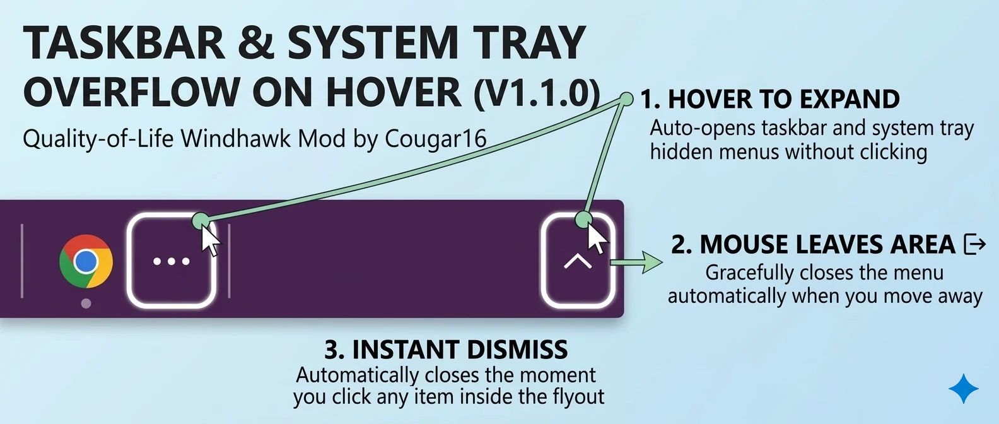

# Taskbar Overflow on Hover 🚀
**Upgrade your Windows 11 experience with this seamless Quality-of-Life enhancement.**

Tired of clicking the small three-dot overflow icon on your taskbar? This mod transforms the overflow menu into a fluid, responsive, zero-click experience. Just hover your mouse over the chevron button, and your hidden system tray icons appear instantly. 

✨ **Smart Features:**
* **Zero-Click Open:** Auto-expands the hidden icons menu just by resting your cursor on the overflow button (300ms default delay, easily adjustable).
* **Auto-Dismiss:** Gracefully closes the menu automatically when your mouse leaves the overflow button or the flyout menu.
* **Instant App Launch:** Instantly dismisses the overflow flyout the exact moment you click an app inside it, bypassing native Windows UI delay.
* **Customizable Delays:** Fine-tune the hover-to-open and hover-to-close timings to perfectly match your personal workflow.

*Developed by Cougar16 for the Windows customization community.*
