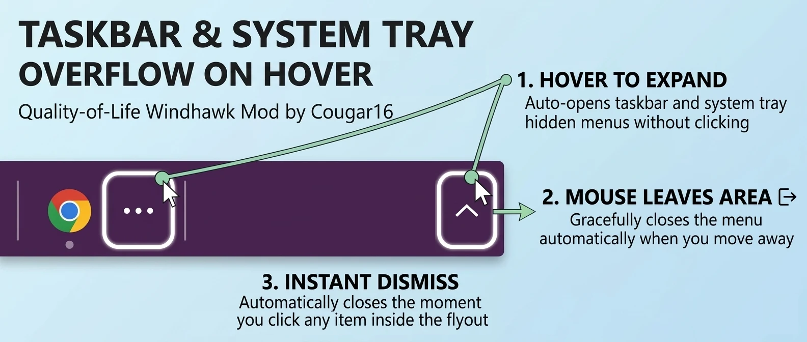

# Taskbar Overflow on Hover 🚀
**Upgrade your Windows 11 experience with this seamless Quality-of-Life enhancement.**

A zero-click QoL upgrade for Windows 11.

Hover over the taskbar app overflow button or the system tray chevron to instantly expand hidden items without clicking.

✨ **Features:**
* **Dual-Zone Zero-Click Open**: Auto-expands both the running app overflow menu ("...") and the system tray hidden icons flyout (the "^" chevron) simply by hovering.
* **Configurable Toggles**: Individually enable or disable hover activation for either menu in the mod settings.
* **Auto-Dismiss**: Smoothly closes the active menu the moment your cursor leaves the button and flyout hit area, complete with debounced overshoot protection so quick mouse sweeps won't cause flickering.
* **Instant Item Launch**: Automatically dismisses the flyout the millisecond you launch an app or click an item inside it, bypassing native Windows UI delay while keeping context menus intact.
* **Multi-DPI & Multi-Language Support**: Per-Monitor V2 DPI awareness guarantees pixel-accurate coordinate mapping on high-scale displays, with native support across localized Windows editions.

*Developed by Cougar16 for the Windows customization community.*
